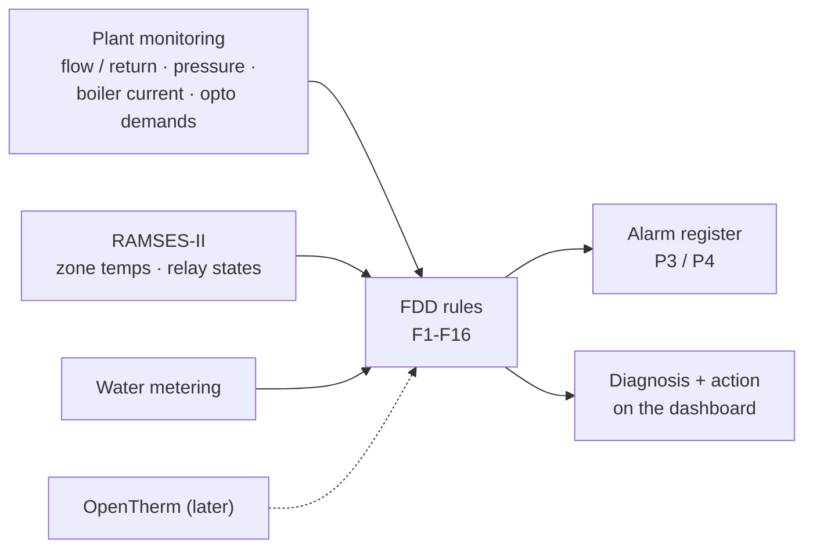

# Fault Detection and Diagnostics (FDD) Rules for a Heating Plant (Design Stage)

**Rule-based fault detection on data the plant already produces, as modern BMS analytics platforms do: short-cycling, firing without demand, low delta-T, pressure decay, sensor drift and disagreement, stuck zones and comfort complaints, each with explicit logic, persistence, a likely cause and a recommended action, feeding the alarm strategy.**

> **The short version:**
> - **Inputs:** plant monitoring (flow/return, pressure, current-based boiler states, demands), RAMSES-II zones, water metering, later OpenTherm data.
> - **Rules:** each one has a condition, a persistence time, a severity, a probable cause and an action, so it isn't just an alarm, it's a diagnosis.
> - **Implementation:** HA template sensors or Node-RED (on the supervisory layer); results feed the alarm register at P3/P4.
> - **Validation:** each rule tested against historical data (true and false positives).

**Portfolio position:** Management level · analytics. Inputs from: [plant monitoring](https://github.com/the-control-cabinet/heating-plant-monitoring-esphome) · [Evohome/RAMSES](https://github.com/the-control-cabinet/evohome-heating-controls-ramses-integration) · [water metering](https://github.com/the-control-cabinet/mains-water-metering-modbus-rtu). Outputs to: [alarm strategy](https://github.com/the-control-cabinet/alarm-and-trend-strategy)

---

## Status at a glance

| Item | Status |
|---|---|
| Rule catalogue F1-F20 (logic, persistence, cause, action) | ✅ Written ([doc 01](docs/01-rules.md)) |
| Implementation approach (HA templates / Node-RED, alarm routing) | 📐 Designed ([doc 02](docs/02-implementation.md)) |
| **F1 short-cycling: confirmed on real data** (4-8 min cycles at low load) | ✅ Evidence recorded ([doc 03](docs/03-validation.md)) |
| F5 pressure-decay baseline (top-up about every two weeks) | ✅ Recorded |
| F13, F15, F16 from the junction box survey | ✅ Written; need opto inputs to run |
| **Rules running live as HA alerts** (F1/F17, F5, F7, F9, F10, F18, F19, F20 now; F2, F15, F16 gated until the opto board's mains side) | ✅ Live 11 Nov ([doc 02](docs/02-implementation.md#live-alerts-11-nov-2026)) · ⏳ true/false-positive log |

## Why FDD, not just alarms

An alarm says *something is wrong*; a fault-detection rule says *what is probably wrong and what to do*. Each rule here has a condition, a persistence time (so transients don't trigger it), a probable cause and an action, the way commercial FDD tools work. They're written against real plant: a system boiler, two unvented cylinders, five zone valves, two Evohome controllers and a monitoring layer that is being built point by point.

## Inputs → rules → actions

## The rules at a glance

| # | Fault | Needs | Status |
|---|---|---|---|
| F1 | Short-cycling | Flow/return (or current) + demand | **Evidence on real data** |
| F2 | Firing without demand | Current + opto demand | Waits for clamp + opto |
| F3 | Low ΔT | Flow/return + firing | Inputs live |
| F4 | High return (not condensing) | Return temperature | Inputs live; returns > 55 °C seen late in long runs |
| F5 | Pressure decay | Pressure | Baseline recorded |
| F6 | Sensor disagreement | NTC + OpenTherm | Waits for OpenTherm |
| F7 | Stuck zone | RAMSES-II | **Live alert** (2 h at ≥ 95% demand, > 1 °C short) |
| F8 | Comfort complaint | RAMSES-II | Inputs live |
| F9 | DHW priority overrun | RAMSES-II | **Live alert** (90 min, on heat demand) |
| F10 | Stale sensor | Any | **Live** for the control-room board (offline 5 min) |
| F11 | Simultaneous heating and cooling | RAMSES-II + aircon | Inputs live |
| F12 | Outdoor sensor disagreement | Weather station + online | Inputs live |
| F13 | Overrun with no flow path (no bypass) | Flow temp + switched live | Bypass required regardless |
| F14 | Restricted radiator circuit | ΔT + zones | Inputs live |
| F15 | Cylinder relay calling, stat not passing | Opto + RAMSES-II | Alert written, gated until opto |
| F16 | Hot water disabled by the timer | Opto + RAMSES-II | Alert written, gated until opto |
| F17-F20 | Low flow, cylinder not warming, inlet overpressure, implausible sensor | Plant monitoring | **Live alerts** (F18 on heat demand) |

Full logic, persistence, causes and actions: [doc 01](docs/01-rules.md).

## First real evidence: F1 short-cycling

With filtered flow and return temperatures, the cycles are unmistakable: at **low heating load** (early morning and the start of the evening period) the boiler fires every **4-8 minutes**, above the rule's threshold of 6 firings an hour. When more zones call later in the evening, burns lengthen and the flow holds at 65-72 °C. The likely cause is load below the boiler's minimum output; RAMSES-II relay states will separate the boiler cycling on its own thermostat from several relays switching it in turn ([validation](docs/03-validation.md)).

**Actions under consideration:** lower the boiler's flow temperature (fewer cycles at low load, more condensing), then weather compensation and anti-cycling in the [OpenTherm design](https://github.com/the-control-cabinet/opentherm-boiler-control-esphome) (clauses 3.3 and 3.6 of the [sequence of operation](https://github.com/the-control-cabinet/heating-sequence-of-operation)).

## How rules are validated

Each rule is run against history and scored on **true and false positives** before it's allowed to raise an alarm ([data/rule-validation.csv](data/rule-validation.csv)). A rule that can't be validated yet stays in "observed" status.

## Documents

| Doc | Contents |
|---|---|
| [01 Rule catalogue](docs/01-rules.md) | Logic, persistence, cause, action |
| [02 Implementation](docs/02-implementation.md) | Where rules run; outputs; severity |
| [03 Validation](docs/03-validation.md) | Testing rules against history |

## Roadmap
- [ ] Rules F2, F5, F10 first (data already available)
- [ ] F1/F3/F4 once the boiler clamp and NTCs are commissioned
- [ ] F15/F16 once the opto inputs are installed (cylinder stat / cut-out and timer watchdogs)
- [ ] F13 validated against the boiler fault history and overrun data
- [ ] Validation against history
- [ ] FDD summary dashboard

## Skills demonstrated (as built)
| Skill | Evidence |
|---|---|
| FDD | Rule catalogue with cause and action |
| Data analysis | Persistence, thresholds, validation against history |
| Integration with alarms | Severity-mapped outputs |
| Plant knowledge | Rules reflect boiler, hydronic and zone behaviour |

📺 [The Control Cabinet on YouTube](https://www.youtube.com/channel/UC5Cupmz7vlfcodpCX7k8iuQ)

*Built and documented by James · part of [The Control Cabinet BMS portfolio](https://github.com/the-control-cabinet/the-control-cabinet). MIT Licence.*
